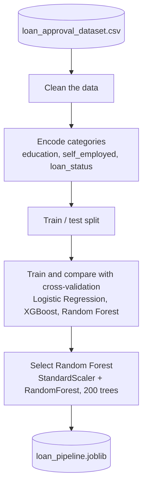
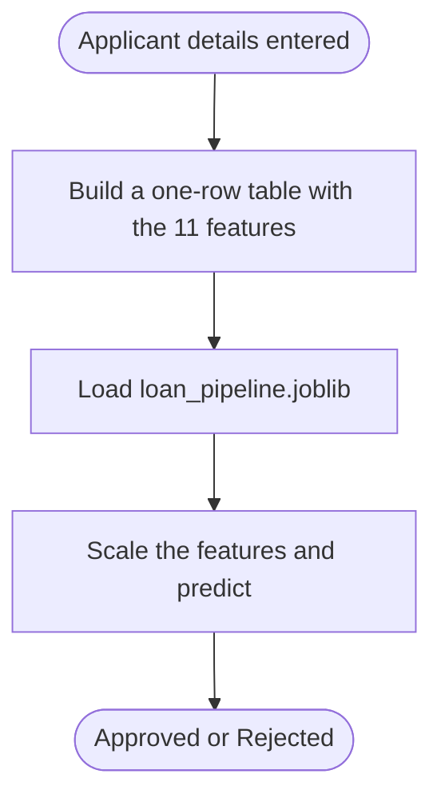

# 🚀 Loan Approval Prediction

Predict whether a loan application will be approved from the applicant's financial profile.

## 📌 Overview

A classification project that learns from historical loan applications (income, loan amount and term, CIBIL score, dependents, education, employment, and asset values). Logistic Regression, XGBoost, and Random Forest were trained and compared; Random Forest performed best and is served through a Streamlit app.

## ✨ Features

* 11 input features covering income, loan details, credit score, and assets
* Compared Logistic Regression, XGBoost, and Random Forest using cross-validation and parameter tuning
* Deployed model: StandardScaler + RandomForestClassifier (200 trees) in a single pipeline
* Streamlit app that returns Approved / Rejected for the entered details

## 🔄 Workflow

Training (in the notebook):



Prediction (in the Streamlit app):



## 🛠️ Tech Stack

* Language: Python
* Libraries: Pandas, NumPy, Scikit-learn, XGBoost (model comparison), Matplotlib, Plotly, Streamlit
* Tools: Git, GitHub, Jupyter Notebook

## 📂 Project Structure

```
loan-approval-prediction/
├── loan_approval_dataset.csv     # dataset
├── loanapprovalproject .ipynb    # EDA, preprocessing, model comparison
├── app1.py                       # Streamlit app
├── loan_pipeline.joblib          # trained scaler + Random Forest pipeline
├── requirements.txt
└── LICENSE
```

## ⚙️ Installation

1. Clone the repository:

```
git clone https://github.com/JAIMINRSOJITRA/loan-approval-prediction.git
```

2. Navigate to the project:

```
cd loan-approval-prediction
```

3. Install dependencies:

```
pip install -r requirements.txt
```

## ▶️ Usage

```
streamlit run app1.py
```

Enter the applicant details and the app shows the predicted decision. Encoding used throughout: Graduate = 1, Self-employed Yes = 1, Approved = 1.

## 📊 Results / Demo

* The app's input columns match the trained pipeline's expected 11 features, and the categorical encodings match training exactly.
* See the notebook for the model-comparison scores.

## 🧠 What I Learned

* Comparing several classifiers fairly and choosing one based on evidence
* Keeping categorical encodings consistent between training and inference
* Wrapping preprocessing and the model in one pipeline

## 🔮 Future Improvements

* Add feature-importance and explanation output for each decision
* Check the model for bias across applicant groups
* Deploy the app publicly

## 🤝 Contributing

Contributions, issues, and suggestions are welcome.

## 📄 License

This project is licensed under the MIT License.

## 👨‍💻 Author

Jaimin Sojitra

* GitHub: https://github.com/JAIMINRSOJITRA
* LinkedIn: https://www.linkedin.com/in/jaimin-sojitra-4683a1277/
